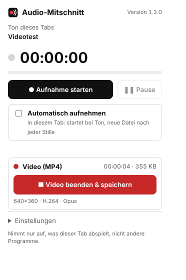

# Audio-Mitschnitt – Browser-Erweiterung

Erweiterung für **Chrome, Edge (und andere Chromium-Browser) sowie Firefox**, die den **Ton des aktuellen Tabs als MP3** und **Videos als MP4** aufnimmt. Sie funktioniert unabhängig vom Betriebssystem (Windows, macOS, Linux) und braucht keine Installation außerhalb des Browsers.



> **Wichtig – was eine Erweiterung kann und was nicht:** Browser lassen Erweiterungen aus Sicherheitsgründen **nicht** an die gesamte Soundausgabe des Computers. Aufgenommen wird nur, was **im Browser-Tab** abgespielt wird (Videos, Musik, Web-Konferenzen im Browser, Web-Apps). Ton anderer Programme (Teams-/Zoom-App, Spotify-App, Systemklänge) erfasst nur die Desktop-App [`../audio-mitschnitt/`](../audio-mitschnitt/README.md).

## Bedienung

1. Im Tab, dessen Ton aufgenommen werden soll, auf das **Symbol der Erweiterung** klicken.
2. **„● Aufnahme starten“**. Das Symbol zeigt nun `REC`. Das Popup darf geschlossen werden, die Aufnahme läuft weiter.
3. Zum Beenden erneut das Symbol anklicken: **„■ Beenden & speichern“**.
4. Die Datei landet unter **Downloads/Mitschnitte/** und heißt wie der Tab, z. B. „(3) Mein Lied - YouTube“ → `Mein Lied.mp3`. Mit der Einstellung „Speicherort jedes Mal fragen“ wird stattdessen nachgefragt.

**Dateinamen:** In Dateinamen verbotene Zeichen (`/ \ : * ? " < > |`) werden entfernt, ebenso der Zusatz „- YouTube“ und der Benachrichtigungszähler „(3)“. Sehr lange Titel werden auf 120 Zeichen gekürzt. Bei gleichem Namen hängt der Browser „(1)“, „(2)“ … an. Lehnt der Browser einen Namen ab (z. B. Umlaute unter Linux ohne UTF-8), wird die ASCII-Form (`Größe` → `Groesse`) verwendet, notfalls `Mitschnitt_JJJJ-MM-TT_hh-mm-ss.mp3`. Bei der Automatik zählt der Titel, der beim ersten Ton der jeweiligen Datei im Tab steht, so heißt in einer Playlist jede Datei wie ihr Video.

Weitere Funktionen:

- **Pause/Weiter**: Die Pausenzeit fehlt in der Datei.
- **Qualität** 96–320 kbit/s (Standard 192), 48 kHz Stereo.
- **Stille bleibt erhalten**: Die Datei läuft synchron zur echten Zeit.
- **Tab geschlossen**: Die Aufnahme wird automatisch beendet und gespeichert.
- Der Ton bleibt während der Aufnahme **hörbar**.
- Es läuft immer nur eine Aufnahme zugleich. Das Popup zeigt an, in welchem Tab.

## Video aufnehmen (MP4)

Im Popup unter **„Video (MP4)“** auf **„🎬 Video aufnehmen“** klicken. Zum Beenden **„■ Video beenden & speichern“**. Start und Stopp erfolgen von Hand.

- Aufgenommen wird das **Video der Seite** (das größte sichtbare, laufende `<video>`, auch in eingebetteten Playern) **mit Ton**. Nur das Video in Originalauflösung bis 1080p, ohne Seitenränder, Menüs oder Mauszeiger. Der Tab darf dabei im Hintergrund liegen.
- **Format:** MP4 mit H.264-Video, Ton AAC (wo der Browser es kann, z. B. Windows/macOS) sonst Opus; 30 Bilder/s. Spielt in VLC, Browsern und aktuellen Playern. Kann ein Browser kein H.264 kodieren, wird VP9 verwendet.
- **Dateiname:** wie der Tab, z. B. `Mein Video.mp4` (Regeln wie bei MP3, siehe oben).
- **Bild und Ton bleiben synchron:** Die Bilder werden auf die Uhr des Tons gestempelt; geprüft mit einem Testvideo aus Blitz und Piepton (Versatz im Mittel unter einem Bild).
- Die Daten fließen während der Aufnahme laufend in die Erweiterung (fragmentiertes MP4). Auch lange Videos belasten die Seite nicht. Wird der Tab geschlossen oder die Seite neu geladen, wird das bis dahin Aufgenommene gespeichert.
- Läuft das Video nicht (Pause), entstehen keine neuen Bilder.
- Ton- und Videoaufnahme können gleichzeitig laufen.

**Nicht möglich:** kopiergeschützte Videos (Netflix, Prime, Disney+ … per DRM) – das Bild bliebe schwarz – und Videos, die von einer fremden Domain ohne Freigabe geladen werden (das Popup meldet das). In Chrome wird nur in Frames aufgenommen, auf die der Klick aufs Symbol Zugriff gibt (Seite selbst; eingebettete Player anderer Domains ggf. nicht). Benötigt Firefox ab 130 bzw. Chrome ab 116 (WebCodecs).

## Automatisch aufnehmen

Im Popup **„Automatisch aufnehmen“** anhaken. Danach braucht es keinen Klick mehr:

- **Start:** Sobald ein Tab Ton abspielt (Lautsprechersymbol am Tab), beginnt die Aufnahme.
- **Neue Datei nach Stille:** Nach einer einstellbaren Zeit Stille wird die Datei gespeichert. Einstellbar unter Einstellungen → „neue Datei nach Stille von … s“, frei eingebbar ab **0,5 s**, Standard 5 s. Die Stille am Ende und vor dem nächsten Ton wird abgeschnitten.
- **Bereit für den nächsten Ton:** Die Aufnahme bleibt danach bereit. Beim nächsten Ton beginnt sofort eine neue Datei, auch nach sehr kurzen Pausen. Eine Playlist wird so automatisch in einzelne Titel geteilt.
- **Zu kurze Stücke verwerfen:** Einstellbar unter „Aufnahmen verwerfen, kürzer als … s“, Standard 3 s, 0 = nichts verwerfen. So landen Benachrichtigungstöne nicht als Datei im Ordner. Aufnahmen ganz ohne Ton werden nie gespeichert.
- **Symbol:** `AUTO`, solange die Automatik auf Ton wartet; `REC`, während Ton aufgenommen wird.
- Ausschalten der Automatik oder „Beenden“ speichert ein laufendes Stück, wenn es lang genug ist.
- Von Hand gestartete Aufnahmen laufen wie gewohnt weiter, bis man sie beendet.

Hinweis: Als Stille gilt ein Pegel unter −60 dBFS.

| | Chrome / Edge | Firefox |
|---|---|---|
| Gilt für | den Tab, in dem die Automatik eingeschaltet wurde. Chrome erlaubt Tab-Aufnahmen nur nach einem Klick auf das Symbol in diesem Tab. Zum Wechseln die Automatik im anderen Tab anhaken. | **alle Tabs**; aufgenommen wird der erste Tab, der Ton abspielt. Wartet die Automatik gerade, wechselt sie zu einem anderen Tab, sobald dieser Ton abspielt. |
| Nach Seitenwechsel | Lädt der Tab eine ganz neue Seite, kann Chrome die Freigabe zurückziehen. Dann zeigt das Popup einen Hinweis, und ein Klick auf das Symbol genügt. | läuft weiter |

## Unterschiede Chrome / Firefox

| | Chrome, Edge, Brave, Opera … | Firefox |
|---|---|---|
| Technik | `tabCapture` (offizielle Tab-Aufnahme) | Firefox bietet keine Tab-Aufnahme. Die Erweiterung greift die `<audio>`/`<video>`-Elemente der Seite über Web Audio ab. |
| Was wird aufgenommen | **alles**, was der Tab ausgibt: Videos, Musik, Web Audio, WebRTC-Anrufe | `<audio>`/`<video>`-Elemente (YouTube, Mediatheken, Podcasts …) und WebRTC-Streams an Media-Elementen |
| Nicht erfasst | – | reine Web-Audio-Ausgaben (z. B. Spiele, manche Synthesizer); Medien von **fremden Domains ohne CORS** (sie spielen normal weiter, fehlen aber in der Aufnahme; das Popup zeigt die Anzahl an) |
| Seitenwechsel im Tab | Aufnahme läuft weiter | Aufnahme läuft weiter, Abgriff wird automatisch neu eingefügt |
| Getestet | automatisiert in Chromium, auch die Automatik (siehe unten) | von Hand in Firefox: Aufnahme auf YouTube (ab 1.0.3), Automatik (1.2.0), Dateinamen aus dem Tabtitel (1.3.0); automatisiert: Hintergrundseite mit nachgebildeter Firefox-API, Abgriff in Chromium simuliert, `web-ext lint` ohne Fehler |

**Diagnose (Firefox):** Klappt etwas nicht, im Popup unten „Diagnose“ aufklappen und „Diagnose kopieren“. Dort steht, in wie viele Frames der Abgriff eingefügt wurde, welche Audio-/Videoelemente er gefunden hat, wie viele Tonblöcke ankommen und welche Fehler auftraten.

Firefox-Besonderheit: Erlaubt die Seite noch keine Tonwiedergabe (Autoplay-Sperre), wartet der Abgriff auf einen Klick in die Seite. Er fasst die Elemente vorher nicht an, damit nichts verstummt.

## Installieren

Erst bauen (Node.js ≥ 18, keine Abhängigkeiten):

```bash
cd audio-mitschnitt-erweiterung
node build.mjs
```

Das erzeugt `dist/chrome/`, `dist/firefox/` sowie je eine ZIP-Datei. Die ZIPs gibt es auch fertig als Artefakt **`audio-mitschnitt-erweiterung`** am Workflow-Lauf auf GitHub (Actions).

**Chrome / Edge**
1. `chrome://extensions` (bzw. `edge://extensions`) öffnen, **Entwicklermodus** einschalten.
2. **„Entpackte Erweiterung laden“** → Ordner `dist/chrome` wählen (bzw. die entpackte ZIP).
3. Symbol über das Puzzle-Menü an die Leiste anheften.

**Firefox**
- Zum Ausprobieren: `about:debugging#/runtime/this-firefox` → **„Temporäres Add-on laden …“** → `dist/firefox/manifest.json`. Das Add-on bleibt bis zum Neustart von Firefox installiert.
- Dauerhaft: Firefox installiert nur von Mozilla signierte Add-ons. Die ZIP bei [addons.mozilla.org](https://addons.mozilla.org/developers/) hochladen (auch „nicht gelistet“ zur eigenen Verteilung möglich) oder mit `web-ext sign` signieren. Alternativ in Firefox ESR/Developer Edition `xpinstall.signatures.required` auf `false` setzen.

Benötigte Berechtigungen: Chrome: `tabCapture`, `offscreen`, `activeTab`, `scripting` (Video-Aufnahme in der Seite), `downloads`, `storage`. Firefox: `<all_urls>` (Abgriff auch in eingebetteten Playern/iframes), `tabs`, `activeTab`, `downloads`, `storage`. Es werden keine Daten gesendet; alles bleibt lokal.

## Aufbau

```
audio-mitschnitt-erweiterung/
├── manifest.chrome.json     Manifest V3 (Service Worker + Offscreen-Dokument)
├── manifest.firefox.json    Manifest V2 (dauerhafte Hintergrundseite)
├── build.mjs                baut dist/chrome, dist/firefox und ZIPs
├── src/
│   ├── lib/
│   │   ├── mischer.js       Quellen mischen; datengetrieben, Stille nur bei Lücken
│   │   ├── aufnahme.js      Mischer + MP3-Kodierung, Pause, Status
│   │   ├── abgriff.js       Abgriff: Tonspur direkt (Chrome), AudioWorklet, ScriptProcessor (Rückfall)
│   │   ├── abgriff-worklet.js  AudioWorklet-Prozessor (verlustfrei im Audio-Thread)
│   │   ├── lame.min.js      lamejs 1.2.1 (MP3-Encoder, LGPL-3.0)
│   │   ├── mp4-muxer.js     mp4-muxer 5.2.2 (MP4-Multiplexer, MIT)
│   │   ├── video.js         Video-Aufnahme in der Seite (WebCodecs H.264/AAC|Opus -> MP4)
│   │   ├── video-sammler.js nimmt die MP4-Daten an, wählt das Video, speichert
│   │   ├── medienquelle.js  gemeinsamer AudioContext/Element-Quellen (Ton + Video)
│   │   └── lizenzen/        Lizenztexte Drittanbieter
│   ├── popup/               Oberfläche (für beide Browser gleich)
│   ├── chrome/              background.js (tabCapture, Download), offscreen.* (Aufnahme)
│   ├── firefox/             background.* (Aufnahme, Download), tap.js (Abgriff in der Seite)
│   └── icons/
└── tests/
    ├── *.test.mjs           Unit-Tests (node --test): Mischer, MP3, Resampler, Automatik,
    │                        Firefox-Hintergrundseite mit nachgebildeter API
    ├── e2e-chrome.mjs       echter Chromium: Erweiterung laden, Töne aufnehmen, MP3 analysieren
    ├── e2e-chrome-automatik.mjs  echter Chromium: Automatik startet bei Ton, endet nach Stille
    ├── e2e-chrome-knistern.mjs   echter Chromium: 12 s Dauer-Sinus, prüft auf Aussetzer (Knistern)
    ├── e2e-chrome-video.mjs      echter Chromium: Video als MP4 aufnehmen; Maße, Ton, Lippensynchronität
    ├── fixtures/testvideo.webm   Testvideo (Blitz + Piepton je Sekunde)
    └── e2e-abgriff.mjs      Firefox-Abgriff in Chromium mit nachgebildeter Erweiterungs-API
```

## Entwickeln & Testen

```bash
npm test                 # Unit-Tests
npm run test:e2e         # baut und testet in Chromium (Playwright nötig; unter Linux: xvfb-run -a npm run test:e2e)
npm run lint:firefox     # Mozilla-Prüfung des Firefox-Pakets
```

**CI:** `.github/workflows/audio-mitschnitt-erweiterung.yml` führt alle Tests aus und stellt die beiden ZIPs als Artefakt bereit.

## Hinweis

Aufnahmen von Gesprächen oder Konferenzen nur mit Einverständnis aller Beteiligten anfertigen (§ 201 StGB). Bei urheberrechtlich geschützten Inhalten gelten die üblichen Grenzen der Privatkopie. Manche Streaming-Dienste schützen ihre Inhalte per DRM. Deren Ton kann eine Erweiterung nicht aufnehmen, dort entsteht Stille.
