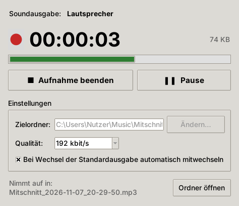

# Audio-Mitschnitt

Desktop-App, die **alles, was auf der eingestellten Soundausgabe ausgegeben wird**, als **MP3** mitschneidet: Videokonferenzen, Browser, Musik, Systemklänge. Genau das, was man über Lautsprecher oder Kopfhörer hört. Kein Mikrofon, kein virtuelles Kabel, keine Zusatzsoftware nötig.



## Funktionen

- **Aufnahme der Standard-Wiedergabe** per Loopback (Windows: WASAPI, Linux: PulseAudio/PipeWire-Monitor)
- **Direkt als MP3** (LAME, 48 kHz, Stereo), wählbar 96–320 kbit/s (Standard 192)
- **Folgt der Soundausgabe:** Wird während der Aufnahme z. B. vom Lautsprecher aufs Headset umgeschaltet, nimmt die App ohne Unterbrechung in derselben Datei weiter auf. Abschaltbar.
- **Gerät abgezogen?** Die Aufnahme wechselt auf die neue Standardausgabe, statt abzubrechen.
- **Stille bleibt erhalten:** Die Datei läuft synchron zur echten Zeit, auch wenn zwischendurch nichts abgespielt wird.
- **Pause/Fortsetzen**, Pegelanzeige, Laufzeit und Dateigröße
- **Absturzsicher:** Die MP3 wird fortlaufend geschrieben; auch bei einem Absturz bleibt das Aufgenommene abspielbar.
- Dateien: `Mitschnitt_JJJJ-MM-TT_hh-mm-ss.mp3`, standardmäßig in `Musik\Mitschnitte`

## Nutzung (Windows)

1. `AudioMitschnitt.exe` starten. Sie liegt als Artefakt **`AudioMitschnitt-windows`** am jeweiligen Lauf des Workflows *Audio-Mitschnitt* (GitHub → Actions).
2. Oben steht, welche Soundausgabe aufgenommen wird (die in Windows eingestellte Standardausgabe).
3. **„● Aufnahme starten“** (oder Leertaste), am Ende **„■ Aufnahme beenden“**.
4. **„Ordner öffnen“** zeigt die fertige Datei im Explorer.

> Windows SmartScreen kann beim ersten Start warnen, weil die EXE nicht signiert ist: „Weitere Informationen“ → „Trotzdem ausführen“.

Die Lautstärke-Einstellung von Windows wirkt sich **nicht** auf die Aufnahme aus. Stummschalten des Lautsprechers ebenfalls nicht, solange die Anwendung selbst Ton ausgibt.

## Kommandozeile

```bash
cd audio-mitschnitt
pip install -r requirements.txt
python -m audio_mitschnitt                 # Fenster
python -m audio_mitschnitt --geraete       # Soundausgaben auflisten (* = wird aufgenommen)
python -m audio_mitschnitt --cli           # Konsole, Ende mit Strg+C
python -m audio_mitschnitt --cli -d 3600 -b 128 -o D:\Mitschnitte   # 1 h, 128 kbit/s
```

| Option | Bedeutung |
|---|---|
| `--cli` | ohne Fenster in der Konsole aufnehmen |
| `-o`, `--ordner` | Zielordner |
| `-b`, `--bitrate` | 96, 128, 160, 192, 256 oder 320 kbit/s |
| `-d`, `--dauer` | nach so vielen Sekunden automatisch beenden |
| `--nicht-folgen` | beim Wechsel der Standardausgabe nicht mitwechseln |
| `--geraete` | Soundausgaben auflisten |

Die Einstellungen des Fensters (Ordner, Qualität, Mitwechseln) werden gespeichert: unter Windows in `%APPDATA%\AudioMitschnitt\einstellungen.json`, unter Linux in `~/.config/audio-mitschnitt/`.

## Plattformen

| System | Status |
|---|---|
| Windows 10/11 | ✔ WASAPI-Loopback, keine Zusatzsoftware |
| Linux (PulseAudio oder PipeWire mit `pipewire-pulse`) | ✔ Monitor-Quelle der Standardausgabe; Fenster benötigt `python3-tk` |
| macOS | ✖ kein System-Loopback; nur mit virtuellem Gerät wie BlackHole, das als Ausgabe eingestellt ist |

## Aufbau

```
audio-mitschnitt/
├── audio-mitschnitt.pyw   Startdatei (Doppelklick unter Windows, Einstieg für die EXE)
├── audio_mitschnitt/
│   ├── quelle.py          Loopback der Standardausgabe (soundcard), COM-Init für Threads
│   ├── recorder.py        Aufnahme-Thread: Lesen, Stille ergänzen, Gerätewechsel, Pause
│   ├── encoder.py         MP3-Kodierung (lameenc), Kanal-/Format-Umwandlung
│   ├── einstellungen.py   gespeicherte Einstellungen (JSON)
│   ├── gui.py             Fenster (Tkinter)
│   └── cli.py             Kommandozeile
└── tests/                 pytest, ohne Audio-Hardware (simulierte Quellen)
```

Das Lesen der Soundausgabe läuft in einem eigenen Thread. PulseAudio liefert bei Stille gar keine Daten, ein direkter Lesezugriff würde dann blockieren. Der Recorder ergänzt fehlende Zeit anhand der Uhr mit Stille, prüft alle 2 s, ob sich die Standardausgabe geändert hat, und bleibt beim Stoppen immer reaktionsfähig.

## Entwickeln & Testen

```bash
cd audio-mitschnitt
pip install -r requirements-dev.txt
python -m pytest -q
```

EXE selbst bauen (unter Windows):

```bash
pip install pyinstaller
pyinstaller --noconfirm --onefile --windowed --name AudioMitschnitt --collect-data soundcard audio-mitschnitt.pyw
```

**CI:** `.github/workflows/audio-mitschnitt.yml` testet unter Windows und Linux und baut danach die Windows-EXE.

## Hinweis

Aufnahmen von Gesprächen oder Konferenzen nur mit Einverständnis aller Beteiligten anfertigen (§ 201 StGB). Bei urheberrechtlich geschützten Inhalten gelten die üblichen Grenzen der Privatkopie.
