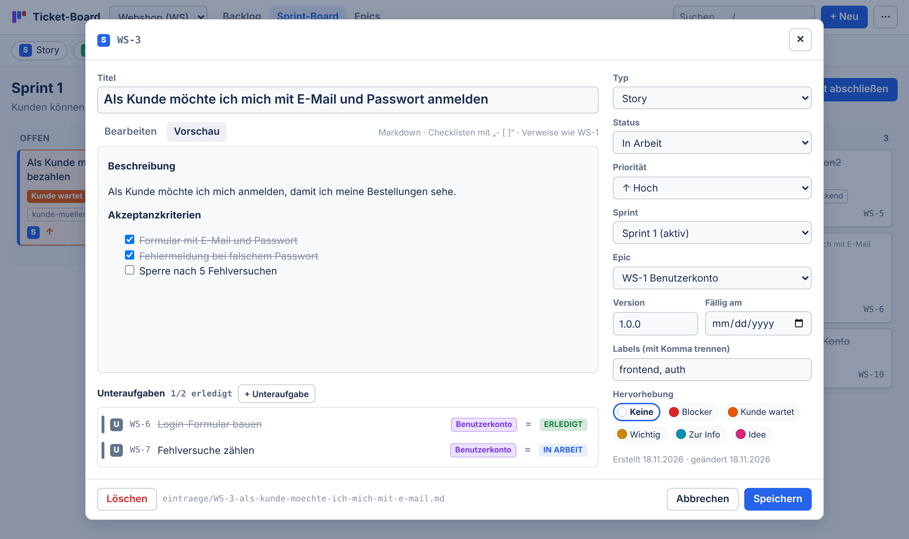

# Ticket-Board

Leichtgewichtiges Ticket-Tool nach dem Vorbild von Jira: **Epics, Stories, Aufgaben, Bugs und Unteraufgaben**, ein **Backlog** mit Sprintplanung und ein **Sprint-Board** mit Drag & Drop. Jeder Eintrag ist eine **eigene Markdown-Datei**. Es gibt keine Datenbank, keinen Account und keine Cloud. Die App läuft lokal im Browser.


## Funktionen

- **Backlog:** aktiver Sprint, geplante Sprints und Backlog untereinander. Einträge per Drag & Drop einplanen und sortieren, Einträge per Eingabezeile schnell anlegen.
- **Sprint-Board:** Spalten *Offen → In Arbeit → Review → Erledigt*, Karten per Drag & Drop verschieben, Fortschritt und Resttage des Sprints.
- **Sprints:** anlegen, starten (immer nur einer gleichzeitig aktiv, Standarddauer 14 Tage) und abschließen. Unerledigtes wandert dabei ins Backlog oder in einen geplanten Sprint.
- **Epics** mit Fortschrittsbalken, **Unteraufgaben**, die automatisch dem Sprint ihres Elternteils folgen.
- **Farben:**
  - Jeder Typ hat eine feste Farbe und ein Buchstaben-Symbol: Epic violett **E**, Story blau **S**, Aufgabe grün **A**, Bug rot **B**, Unteraufgabe grau **U**.
  - Wichtige Einträge bekommen eine **Hervorhebung mit Bedeutung**: Blocker, Kunde wartet, Wichtig, Zur Info, Idee. Die Liste ist pro Projekt anpassbar. Die Hervorhebung färbt Rahmen und Hintergrund, der Typstreifen bleibt sichtbar.
- **Felder:** Status, Priorität, Sprint, Epic, **Version**, **Fälligkeitsdatum** (überfällig = rot, bald fällig = gelb), Labels und eine freie Beschreibung in Markdown mit Vorschau. Checklisten lassen sich in der Vorschau abhaken, Verweise wie `WS-12` sind anklickbar.
- **Filter und Suche:** nach Typ, Epic, Version, Hervorhebung und „Überfällig“, außerdem Volltextsuche.
- **Änderungen von außen:** Bearbeitest du eine Datei im Texteditor, aktualisiert sich die Ansicht nach etwa 2 s. Wurde ein gerade geöffneter Eintrag inzwischen geändert, fragt die App, welche Fassung gilt.
- **Abgleich über Git:** ein Knopf, der Änderungen sichert, Neues vom Server holt, feldweise zusammenführt und überträgt. So nutzt du dasselbe Projekt auf mehreren Rechnern oder legst die Tickets direkt neben den Code (Anleitung: [Abgleich über Git](#abgleich-über-git)).
- **Mehrere Projekte**, helles und dunkles Design, Tastenkürzel.


## Starten

Voraussetzung ist nur **Python 3.10 oder neuer**. Es werden keine weiteren Pakete benötigt.

```bash
cd ticket-board
python -m ticket_board
```

Der Browser öffnet `http://127.0.0.1:8765/`. Standardmäßig liegen die Daten in `~/Tickets` (Windows: `C:\Users\<Name>\Tickets`).

**Windows:** Ein Doppelklick auf `ticket-board.pyw` startet die App ohne Konsolenfenster. Beendet wird sie über **⋯ → App beenden**. Ein zweiter Doppelklick, während die App schon läuft, öffnet nur den Browser.

```bash
python -m ticket_board D:\Projekte\Tickets       # anderer Arbeitsbereich
python -m ticket_board beispiel                  # Beispielprojekt „Webshop“ ansehen
python -m ticket_board -p 9000 --kein-browser    # anderer Port, Browser nicht öffnen
```

| Option | Bedeutung |
|---|---|
| `ORDNER` | Arbeitsbereich mit Projektordnern **oder** ein einzelner Projektordner |
| `-p`, `--port` | Port auf 127.0.0.1 (Standard 8765; ist er belegt, wird ein freier gewählt) |
| `--kein-browser` | Browser nicht automatisch öffnen |

## Projekte

Die App öffnet einen **Arbeitsbereich**: einen Ordner, in dem jedes Projekt ein eigener Unterordner ist. In der Kopfzeile wechselst du zwischen den Projekten, über **⋯ → Neues Projekt** legst du weitere an.

Jedes Projekt bleibt ein eigenständiger Ordner. Du kannst ihn verschieben, sichern oder in ein Git-Repo legen, etwa als `docs/tickets/` direkt neben den Code. Zeigt man der App direkt auf einen Projektordner, also einen Ordner mit `projekt.md`, öffnet sie nur dieses eine Projekt.

## Dateiformat

```
Tickets/                          ← Arbeitsbereich
└── Webshop/                      ← Projekt
    ├── projekt.md                Name, Kürzel (WS), Sprintdauer, Hervorhebungen
    ├── sprints/
    │   ├── sprint-01.md          Name, Status (geplant/aktiv/abgeschlossen), Ziel, Start, Ende
    │   └── sprint-02.md
    ├── eintraege/
    │   ├── WS-1-benutzerkonto.md
    │   └── WS-4-anmeldung-schlaegt-bei-umlauten-im.md
    └── .papierkorb/              gelöschte Einträge (nichts geht verloren)
```

Ein Eintrag besteht aus Frontmatter (Metadaten) und freiem Markdown-Text:

```markdown
---
id: WS-4
typ: bug                 # epic | story | aufgabe | bug | unteraufgabe
titel: Anmeldung schlägt bei Umlauten im Passwort fehl
status: in-arbeit        # offen | in-arbeit | review | erledigt
prioritaet: kritisch     # niedrig | mittel | hoch | kritisch
sprint: sprint-01        # leer = Backlog
epic: WS-1
version: "1.0.0"
faellig: 2026-11-20
farbe: "#dc2626"         # Hervorhebung, leer = keine
labels: [auth]
rang: 2000               # Reihenfolge im Sprint/Backlog
erstellt: 2026-11-18
aktualisiert: 2026-11-18
---
## Schritte zum Nachstellen

1. Konto mit Passwort `Grüße123` anlegen
…
```

- Die nächste freie ID wird aus den vorhandenen Dateien berechnet (auch aus dem Papierkorb), nicht gespeichert. So gibt es beim Git-Abgleich keine Konflikte in `projekt.md`.
- Ob ein Eintrag im Backlog oder in einem Sprint liegt, steht **nur im Feld `sprint`**. Dateien werden nie verschoben, und der **Dateiname bleibt stabil**, auch wenn sich der Titel ändert. Die ID steht im Frontmatter.
- Unteraufgaben haben zusätzlich `eltern: WS-3`.
- **Von Hand bearbeiten ist ausdrücklich erlaubt.** Felder, die die App nicht kennt (z. B. `punkte: 5`), bleiben beim Speichern erhalten. Geschrieben werden nur Felder, die sich tatsächlich geändert haben. Dateien werden atomar gespeichert, es entstehen also nie halb geschriebene Dateien.
- Nicht lesbare Dateien (fehlendes Frontmatter, doppelte ID, unbekannter Status …) bringen die App nicht zum Absturz. Sie erscheinen im Reiter **Probleme**.
- Das Format ist mit Obsidian und anderen Markdown-Editoren kompatibel.



## Abgleich über Git

Mit Git liegt ein Projekt auf einem Server (GitHub, GitLab, eigener Server oder ein geteilter Ordner) und lässt sich auf mehreren Rechnern bearbeiten. In der App gibt es dafür drei Wege:

| Situation | In der App |
|---|---|
| Neues Projekt zum ersten Mal auf den Server bringen | **⋯ → Git-Abgleich …** → Adresse → **Einrichten** |
| Projekt, das schon auf dem Server liegt, auf diesen Rechner holen | **⋯ → Projekt aus Git holen …** → Adresse → **Holen** |
| Im Alltag holen und pushen | **⟳ Abgleichen** in der Kopfzeile |

> **Wichtig:** Die App legt nur das **lokale** Repository auf deinem Rechner an. Das **Repository auf dem Server legst du selbst an, und es muss leer sein**: ohne README, `.gitignore` und Lizenz. Ist es nicht leer, bricht die App beim Einrichten ab, damit nichts überschrieben wird.

### 1. Einmalig: Rechner vorbereiten

1. [Git](https://git-scm.com/downloads) installieren. Unter Windows bringt „Git for Windows“ den Git Credential Manager für die Anmeldung bei GitHub mit.
2. Git einmal deinen Namen und deine E-Mail-Adresse mitteilen. Sie stehen später in jedem Commit:
   ```bash
   git config --global user.name "Dein Name"
   ```
   ```bash
   git config --global user.email "du@example.com"
   ```
3. Anmeldung beim Server klären:
   - **HTTPS** (`https://github.com/…/….git`): Beim ersten Push öffnet der Git Credential Manager ein Browserfenster zur GitHub-Anmeldung. Danach merkt er sich die Anmeldung.
   - **SSH** (`git@github.com:…/….git`): Dein SSH-Schlüssel muss bei GitHub hinterlegt sein (GitHub → Settings → SSH and GPG keys).

Das Ticket-Board fragt nie selbst nach Passwörtern. Fehlt eine Anmeldung, erscheint eine Meldung, statt dass die App hängen bleibt.

### 2. Neues Projekt auf den Server bringen (erster Rechner)

1. **Leeres Repository auf dem Server anlegen**, z. B. auf GitHub: **New repository** → Name eingeben → *Private* oder *Public* wählen. Bei *README*, *.gitignore* und *License* **nichts** auswählen → **Create repository**. Die angezeigte Adresse kopieren, z. B. `https://github.com/develkd/ticket_repro.git`.
   *Geteilter Ordner statt GitHub* (Netzlaufwerk, OneDrive): einmalig `git init --bare D:\Sync\tickets.git` ausführen und diesen Pfad als Adresse nehmen.
2. Ticket-Board starten und das Projekt wählen.
3. **⋯ → Git-Abgleich …** → Adresse einfügen → **Einrichten**.

Die App führt `git init` im Projektordner aus, legt `.gitattributes` und `.gitignore` an, erstellt den ersten Commit, trägt die Adresse als `origin` ein und pusht. Danach erscheint in der Kopfzeile der Knopf **⟳ Abgleichen**.

Ohne Adresse wird das Projekt nur lokal versioniert. Die Adresse lässt sich später unter **⋯ → Git-Abgleich …** nachtragen.

### 3. Vorhandenes Projekt auf einen weiteren Rechner holen

1. Ticket-Board starten (Arbeitsbereich, z. B. `~/Tickets`).
2. **⋯ → Projekt aus Git holen …** → dieselbe Adresse wie auf dem ersten Rechner → **Holen**. Der Ordnername ist optional; ohne Angabe wird er aus der Adresse gebildet.
3. Das Projekt erscheint in der Projektauswahl und ist sofort für den Abgleich eingerichtet.

Hol das Projekt nur auf diesem Weg und nicht zusätzlich als Kopie oder ZIP, sonst liegt es zweimal im Arbeitsbereich.

**Beispiel:** Die Tickets zur Weiterentwicklung dieses Tools liegen in [develkd/ticket_repro](https://github.com/develkd/ticket_repro). Holen mit der Adresse `https://github.com/develkd/ticket_repro.git`.

### 4. Im Alltag: holen und pushen

Der Knopf **⟳ Abgleichen** zeigt die Zahl der Änderungen, die noch nicht auf dem Server sind. Ein Klick:

1. committet die Änderungen im Projektordner, und **nur dort**. Liegt das Projekt in einem Code-Repository (z. B. `docs/tickets/`), bleibt dein übriger Code unangetastet.
2. holt Neues vom Server (`git fetch`) und führt es zusammen (`git merge`).
3. pusht alles (`git push`).

Unter **⋯ → Git-Abgleich …** lässt sich pro Rechner ein **automatischer Abgleich alle 5 Minuten** einschalten. Dort steht auch, wie viele Änderungen noch nicht übertragen sind und wie viele neu auf dem Server liegen.

**Tipp:** Vor dem Wechsel an einen anderen Rechner abgleichen und dort zuerst abgleichen, dann gibt es kaum Konflikte.

### Konflikte

Konflikte werden feldweise gelöst, nicht zeilenweise wie bei Git:

| Situation | Ergebnis |
|---|---|
| Auf Rechner A Status geändert, auf Rechner B Version | beides übernommen, ohne Rückfrage |
| Beschreibung an verschiedenen Stellen geändert | beides übernommen (`git merge-file`) |
| `aktualisiert` auf beiden Seiten geändert | das neuere Datum gilt |
| `rang` (Reihenfolge) auf beiden Seiten geändert | die Reihenfolge dieses Rechners gilt |
| **dasselbe Feld** auf beiden Seiten unterschiedlich | Die App fragt: „Meine behalten“ oder „Andere übernehmen“, je Eintrag oder für alle. Bis dahin siehst du deine Fassung. „Abgleich abbrechen“ stellt den Stand vor dem Abgleich wieder her. |
| Auf zwei Rechnern dieselbe ID vergeben (zweimal WS-15) | Der lokal neu angelegte Eintrag bekommt die nächste freie Nummer. Verweise (Epic, Elternteil) werden angepasst. |

Konflikte außerhalb des Ticket-Ordners löst das Ticket-Board nicht selbst. Es bricht dann ab und nennt die Dateien.

### Häufige Meldungen

| Meldung | Was tun |
|---|---|
| „Git kennt deinen Namen noch nicht“ | die beiden `git config`-Befehle aus Schritt 1 ausführen |
| „Anmeldung beim Git-Server fehlgeschlagen“ | HTTPS: einmal in einer Konsole `git push` im Projektordner ausführen und im Browserfenster anmelden. SSH: Schlüssel bei GitHub hinterlegen. |
| „Auf dem Server liegt bereits ein anderes Projekt …“ | Das Server-Repository ist nicht leer. Entweder das Projekt mit **Projekt aus Git holen …** holen oder ein neues, leeres Repository anlegen. |
| „Der Git-Server ist nicht erreichbar“ | Internetverbindung bzw. Adresse prüfen |

### Auch ohne App

Die Tickets sind normale Markdown-Dateien in einem Git-Repository. Holen und pushen geht deshalb auch direkt mit Git:

```bash
git clone https://github.com/develkd/ticket_repro.git ~/Tickets/ticket_repro
```
```bash
git -C ~/Tickets/ticket_repro pull
```
```bash
git -C ~/Tickets/ticket_repro add -A && git -C ~/Tickets/ticket_repro commit -m "Tickets" && git -C ~/Tickets/ticket_repro push
```

## Tastenkürzel

| Taste | Aktion |
|---|---|
| `c` | Neuer Eintrag |
| `/` | Suchen |
| `b` / `s` / `e` | Backlog / Sprint-Board / Epics |
| `Strg`+`Enter` | Im Dialog speichern |
| `Esc` | Dialog schließen |
| `?` | Hilfe |

## Sicherheit

Der Server lauscht nur auf `127.0.0.1` und ist damit aus dem Netzwerk nicht erreichbar. Er nimmt nur Anfragen mit dem Host `127.0.0.1`/`localhost` an (Schutz vor DNS-Rebinding). Schreibende Anfragen brauchen einen eigenen Header und JSON, damit fremde Webseiten im selben Browser nichts ändern können. Pfade aus Anfragen werden nie direkt zu Dateipfaden zusammengesetzt.

## Aufbau

```
ticket-board/
├── ticket-board.pyw          Startdatei für Windows (Doppelklick)
├── ticket_board/
│   ├── __main__.py           Kommandozeile, Start, Browser öffnen
│   ├── server.py             HTTP-Server (Standardbibliothek) und JSON-API
│   ├── speicher.py           Projekte, Sprints, Einträge ↔ Markdown-Dateien
│   ├── frontmatter.py        Frontmatter lesen/schreiben, unbekannte Felder bleiben erhalten
│   ├── git_abgleich.py       Git-Abgleich, feldweises Zusammenführen, doppelte IDs
│   └── static/               Oberfläche: HTML, CSS, JavaScript ohne Framework
├── beispiel/Webshop/         Beispielprojekt
└── tests/                    pytest (Speicher, Frontmatter, Server, Git mit zwei simulierten Geräten) und Browser-Test
```

## Entwickeln & Testen

```bash
cd ticket-board
pip install -r requirements-dev.txt
python -m pytest -q
```

Browser-Test (Chromium über Playwright). Er startet den Server auf einer Kopie von `beispiel/` und klickt die wichtigsten Abläufe durch, einschließlich Git-Abgleich mit einem zweiten „Gerät“:

```bash
npm install --no-save playwright
npx playwright install chromium
node tests/e2e_browser.mjs
```

## Ideen für später

Burndown-Chart, Verknüpfungen („blockiert durch“), Vorlagen, Kommandozeile zum Anlegen (`ticket neu bug "…"`), Export als CSV/HTML.
