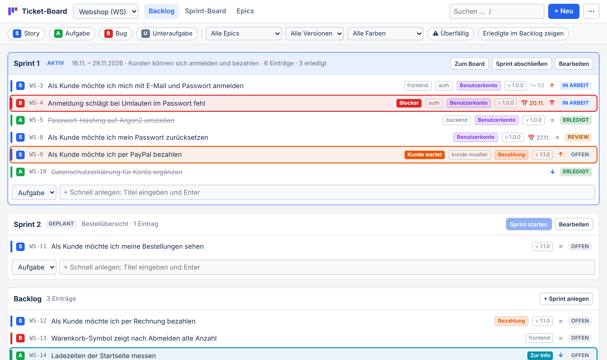
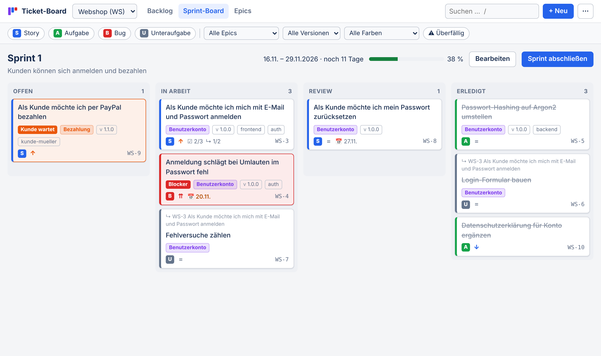

# Ticket-Board

Leichtgewichtiges Ticket-Tool nach dem Vorbild von Jira: **Epics, Stories, Aufgaben, Bugs und Unteraufgaben**, ein **Backlog** mit Sprintplanung und ein **Sprint-Board** mit Drag & Drop. Jeder Eintrag ist eine **eigene Markdown-Datei**. Es gibt keine Datenbank, keinen Account und keine Cloud. Die App läuft lokal im Browser.



## Funktionen

- **Backlog:** aktiver Sprint, geplante Sprints und Backlog untereinander. Einträge per Drag & Drop einplanen und sortieren, Einträge per Eingabezeile schnell anlegen.
- **Sprint-Board:** Spalten *Offen → In Arbeit → Review → Erledigt*, Karten per Drag & Drop verschieben, Fortschritt und Resttage des Sprints.
- **Sprints:** anlegen, starten (immer nur einer gleichzeitig aktiv, Standarddauer 14 Tage) und abschließen. Unerledigtes wandert dabei ins Backlog oder in einen geplanten Sprint.
- **Epics** mit Fortschrittsbalken, **Unteraufgaben**, die automatisch dem Sprint ihres Elternteils folgen.
- **Farben:**
  - Jeder Typ hat eine feste Farbe und ein Buchstaben-Symbol: Epic violett **E**, Story blau **S**, Aufgabe grün **A**, Bug rot **B**, Unteraufgabe grau **U**.
  - Wichtige Einträge bekommen eine **Hervorhebung mit Bedeutung**: Blocker, Kunde wartet, Wichtig, Zur Info, Idee. Die Liste ist pro Projekt anpassbar. Die Hervorhebung färbt Rahmen und Hintergrund, der Typstreifen bleibt sichtbar.
- **Felder:** Status, Priorität, Sprint, Epic, **Version**, **Fälligkeitsdatum** (überfällig = rot, bald fällig = gelb), Labels und eine freie Beschreibung in Markdown mit Vorschau. Checklisten lassen sich in der Vorschau abhaken, Verweise wie `WS-12` sind anklickbar.
- **Filter und Suche:** nach Typ, Epic, Version, Hervorhebung und „Überfällig“, außerdem Volltextsuche.
- **Änderungen von außen:** Bearbeitest du eine Datei im Texteditor, aktualisiert sich die Ansicht nach etwa 2 s. Wurde ein gerade geöffneter Eintrag inzwischen geändert, fragt die App, welche Fassung gilt.
- **Mehrere Projekte**, helles und dunkles Design, Tastenkürzel.



## Starten

Voraussetzung ist nur **Python 3.10 oder neuer**. Es werden keine weiteren Pakete benötigt.

```bash
cd ticket-board
python -m ticket_board
```

Der Browser öffnet `http://127.0.0.1:8765/`. Standardmäßig liegen die Daten in `~/Tickets` (Windows: `C:\Users\<Name>\Tickets`).

**Windows:** Ein Doppelklick auf `ticket-board.pyw` startet die App ohne Konsolenfenster. Beendet wird sie über **⋯ → App beenden**. Ein zweiter Doppelklick, während die App schon läuft, öffnet nur den Browser.

```bash
python -m ticket_board D:\Projekte\Tickets       # anderer Arbeitsbereich
python -m ticket_board beispiel                  # Beispielprojekt „Webshop“ ansehen
python -m ticket_board -p 9000 --kein-browser    # anderer Port, Browser nicht öffnen
```

| Option | Bedeutung |
|---|---|
| `ORDNER` | Arbeitsbereich mit Projektordnern **oder** ein einzelner Projektordner |
| `-p`, `--port` | Port auf 127.0.0.1 (Standard 8765; ist er belegt, wird ein freier gewählt) |
| `--kein-browser` | Browser nicht automatisch öffnen |

## Projekte

Die App öffnet einen **Arbeitsbereich**: einen Ordner, in dem jedes Projekt ein eigener Unterordner ist. In der Kopfzeile wechselst du zwischen den Projekten, über **⋯ → Neues Projekt** legst du weitere an.

Jedes Projekt bleibt ein eigenständiger Ordner. Du kannst ihn verschieben, sichern oder in ein Git-Repo legen, etwa als `docs/tickets/` direkt neben den Code. Zeigt man der App direkt auf einen Projektordner, also einen Ordner mit `projekt.md`, öffnet sie nur dieses eine Projekt.

## Dateiformat

```
Tickets/                          ← Arbeitsbereich
└── Webshop/                      ← Projekt
    ├── projekt.md                Name, Kürzel (WS), ID-Zähler, Sprintdauer, Hervorhebungen
    ├── sprints/
    │   ├── sprint-01.md          Name, Status (geplant/aktiv/abgeschlossen), Ziel, Start, Ende
    │   └── sprint-02.md
    ├── eintraege/
    │   ├── WS-1-benutzerkonto.md
    │   └── WS-4-anmeldung-schlaegt-bei-umlauten-im.md
    └── .papierkorb/              gelöschte Einträge (nichts geht verloren)
```

Ein Eintrag besteht aus Frontmatter (Metadaten) und freiem Markdown-Text:

```markdown
---
id: WS-4
typ: bug                 # epic | story | aufgabe | bug | unteraufgabe
titel: Anmeldung schlägt bei Umlauten im Passwort fehl
status: in-arbeit        # offen | in-arbeit | review | erledigt
prioritaet: kritisch     # niedrig | mittel | hoch | kritisch
sprint: sprint-01        # leer = Backlog
epic: WS-1
version: "1.0.0"
faellig: 2026-11-20
farbe: "#dc2626"         # Hervorhebung, leer = keine
labels: [auth]
rang: 2000               # Reihenfolge im Sprint/Backlog
erstellt: 2026-11-18
aktualisiert: 2026-11-18
---
## Schritte zum Nachstellen

1. Konto mit Passwort `Grüße123` anlegen
…
```

- Ob ein Eintrag im Backlog oder in einem Sprint liegt, steht **nur im Feld `sprint`**. Dateien werden nie verschoben, und der **Dateiname bleibt stabil**, auch wenn sich der Titel ändert. Die ID steht im Frontmatter.
- Unteraufgaben haben zusätzlich `eltern: WS-3`.
- **Von Hand bearbeiten ist ausdrücklich erlaubt.** Felder, die die App nicht kennt (z. B. `punkte: 5`), bleiben beim Speichern erhalten. Geschrieben werden nur Felder, die sich tatsächlich geändert haben. Dateien werden atomar gespeichert, es entstehen also nie halb geschriebene Dateien.
- Nicht lesbare Dateien (fehlendes Frontmatter, doppelte ID, unbekannter Status …) bringen die App nicht zum Absturz. Sie erscheinen im Reiter **Probleme**.
- Das Format ist mit Obsidian und anderen Markdown-Editoren kompatibel.


## Tastenkürzel

| Taste | Aktion |
|---|---|
| `c` | Neuer Eintrag |
| `/` | Suchen |
| `b` / `s` / `e` | Backlog / Sprint-Board / Epics |
| `Strg`+`Enter` | Im Dialog speichern |
| `Esc` | Dialog schließen |
| `?` | Hilfe |

## Sicherheit

Der Server lauscht nur auf `127.0.0.1` und ist damit aus dem Netzwerk nicht erreichbar. Er nimmt nur Anfragen mit dem Host `127.0.0.1`/`localhost` an (Schutz vor DNS-Rebinding). Schreibende Anfragen brauchen einen eigenen Header und JSON, damit fremde Webseiten im selben Browser nichts ändern können. Pfade aus Anfragen werden nie direkt zu Dateipfaden zusammengesetzt.

## Aufbau

```
ticket-board/
├── ticket-board.pyw          Startdatei für Windows (Doppelklick)
├── ticket_board/
│   ├── __main__.py           Kommandozeile, Start, Browser öffnen
│   ├── server.py             HTTP-Server (Standardbibliothek) und JSON-API
│   ├── speicher.py           Projekte, Sprints, Einträge ↔ Markdown-Dateien
│   ├── frontmatter.py        Frontmatter lesen/schreiben, unbekannte Felder bleiben erhalten
│   └── static/               Oberfläche: HTML, CSS, JavaScript ohne Framework
├── beispiel/Webshop/         Beispielprojekt
└── tests/                    pytest (Speicher, Frontmatter, Server) und Browser-Test
```

## Entwickeln & Testen

```bash
cd ticket-board
pip install -r requirements-dev.txt
python -m pytest -q
```

Browser-Test (Chromium über Playwright). Er startet den Server auf einer Kopie von `beispiel/` und klickt die wichtigsten Abläufe durch:

```bash
npm install --no-save playwright
npx playwright install chromium
node tests/e2e_browser.mjs
```

## Ideen für später

Burndown-Chart, Verknüpfungen („blockiert durch“), Vorlagen, Kommandozeile zum Anlegen (`ticket neu bug "…"`), Export als CSV/HTML, Abgleich im Team über Git.
